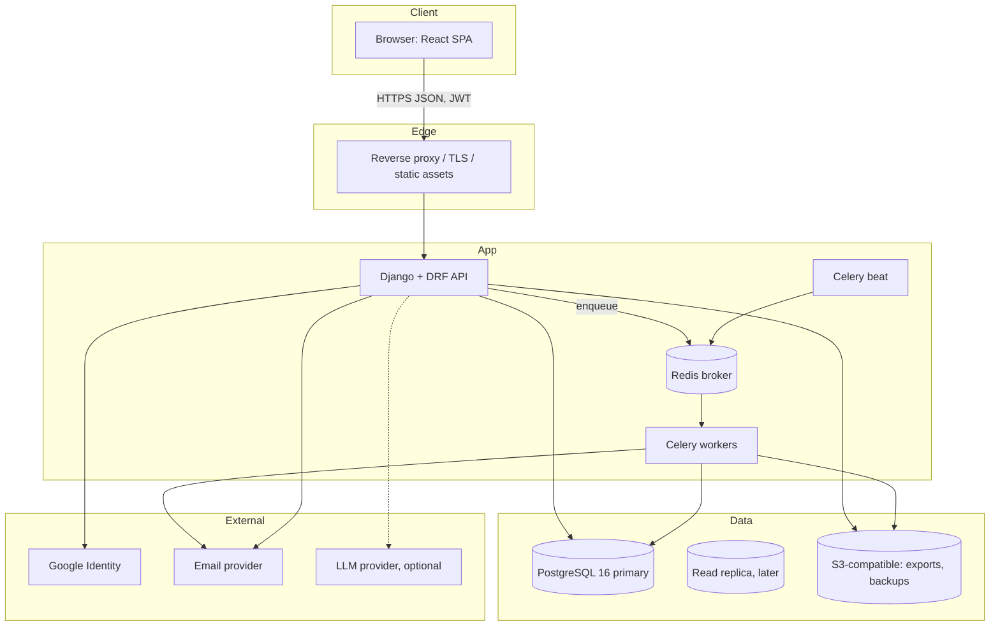
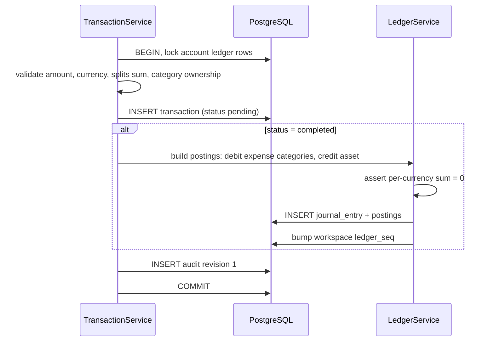
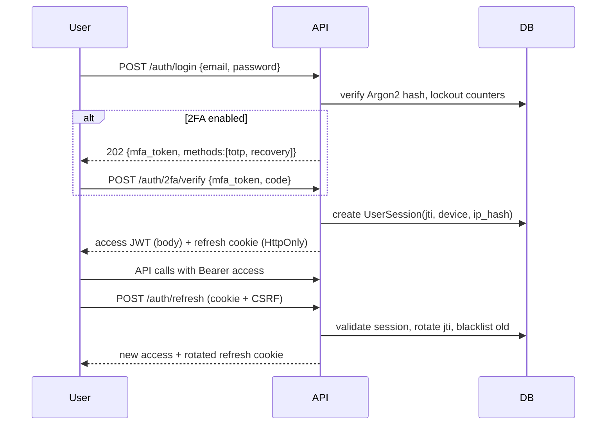
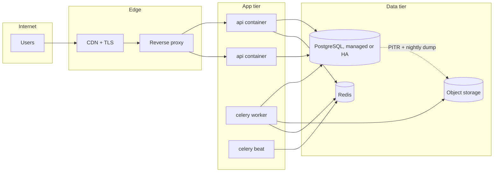

# System Architecture — XakuFinance

**Status:** planning baseline, nothing implemented.
**Companions:** `docs/DATABASE.md`, `docs/ACCOUNTING_RULES.md`, `docs/API_SPECIFICATION.md`,
`docs/SECURITY.md`, `docs/adr/`.

---

## 1. Architectural principles

1. **Ledger first.** Every financial feature is a producer of journal entries. No feature owns a
   balance.
2. **One write path per invariant.** Money rules live in domain services; views, serializers, Celery
   tasks, and admin all call the same service.
3. **Derive, then cache.** Balances and reports derive from postings. Caches carry a ledger version and
   are discarded when it moves.
4. **Boring infrastructure.** PostgreSQL, Redis, Celery, S3-compatible storage. No event bus, no
   microservices, no CQRS framework.
5. **Privacy by construction.** Every financial row carries `workspace_id`; every query is scoped by a
   manager that requires a workspace context.
6. **Generated contracts.** OpenAPI from DRF via drf-spectacular; the TypeScript client is generated, so
   frontend and backend cannot drift silently.
7. **Degrade gracefully.** Google auth, email, AI, and object storage are optional in development; the
   core finance loop works without them.

## 2. System context



The read replica is a later scaling step; V1 reads from the primary. AI is behind a flag and never on a
financial calculation path.

## 3. Backend architecture

### 3.1 Layering

```
HTTP request
  └─ View / ViewSet        auth, permissions, throttles, request parsing, response shaping
      └─ Serializer        input validation, shape; may call services for pure validation only
          └─ Service       ALL business rules, atomicity, locking, ledger calls, audit
              ├─ Selectors read models, aggregates, report queries (no writes)
              ├─ Ledger engine    postings, balancing, reversal, reconciliation
              └─ Models       constraints, indexes, invariants that the DB can enforce
```

Rules:

- Views never mutate a financial model directly.
- Serializers never compute balances, totals, or rates.
- Services accept a `workspace` and an `actor`; they never read `request` globals.
- Selectors are the only place with complex ORM aggregation; they return typed dataclasses or dicts.
- Cross-app imports go through a small `apps.<domain>.services` public API, never deep model imports.

### 3.2 Apps

| App | Responsibility |
|---|---|
| `common` | Base models, mixins, money types, period utilities, error types, pagination, idempotency |
| `identity` | User, profile, sessions, email verification, password reset, Google identity, 2FA, recovery codes |
| `workspaces` | Workspace, settings, dashboard layout, workspace-scoped manager |
| `accounts` | Financial accounts, lifecycle, account read models |
| `ledger` | Ledger accounts, journal entries, postings, reversal, reconciliation, FX clearing |
| `categories` | Expense/income categories and their ledger accounts |
| `tags` | Tags and transaction-tag links |
| `transactions` | Transactions, splits, transfers, opening balances, audit, search |
| `budgets` | Budgets, periods, rollover, spending calculation |
| `savings` | Goals, contributions, earmark allocation |
| `debts` | Liabilities, repayments, interest records |
| `analytics` | Net worth, Safe-to-Spend, daily allowance, emergency fund, snapshots, reports |
| `insights` | Verified summary builder, optional LLM explanation, persisted insight records |
| `notifications` | Notifications, preferences, delivery, quiet hours, digests |
| `datamanagement` | Import jobs, duplicate detection, export jobs, backups, restore |
| `audit` | Cross-cutting audit events (security events, privacy actions) |

### 3.3 Request pipeline

```mermaid
sequenceDiagram
  participant C as Client
  participant M as Middleware (request id, security headers)
  participant A as JWT auth + throttles
  participant V as ViewSet
  participant S as Serializer
  participant SVC as Domain service
  participant L as Ledger engine
  participant DB as PostgreSQL
  C->>M: HTTPS + Bearer access token
  M->>A: request id attached
  A->>V: authenticated user
  V->>V: resolve workspace from user (never from payload)
  V->>S: validate payload
  S->>SVC: validated data + workspace + actor
  SVC->>DB: BEGIN; SELECT ... FOR UPDATE
  SVC->>L: build balanced postings
  L->>DB: INSERT journal entry + postings + audit
  SVC->>DB: COMMIT
  SVC-->>V: domain result
  V-->>C: 2xx with resource representation
```

Idempotency: financial POSTs accept `Idempotency-Key`. The record is stored in the same transaction as
the effect; a replay returns the stored response and never re-executes.

### 3.4 Error model

Uniform envelope (details in API spec):

```json
{
  "error": {
    "code": "insufficient_funds",
    "message": "This transfer needs 120.00 USD but the account has 80.00 USD available.",
    "field": "amount",
    "details": {"available": "80.00", "requested": "120.00"}
  },
  "request_id": "01J..."
}
```

Domain exceptions map to stable codes; unexpected exceptions never leak SQL, stack traces, or model
names.

## 4. Financial ledger architecture

### 4.1 Model

- `LedgerAccount` — one per financial Account and one per Liability, plus system accounts (income,
  expense, equity, FX clearing). Kinds: asset, liability, equity, income, expense.
- `JournalEntry` — immutable, timestamped, carries `effective_date`, `status`
  (`pending|posted|reversed|cancelled`), `entry_type`, `source` reference, `fx_snapshot`,
  `workspace_ledger_seq`.
- `Posting` — immutable debit-positive amount in one currency, referencing one ledger account.

Invariants:

1. `sum(posting.amount_minor) = 0` for each `(entry, currency)`.
2. A posting's currency must match its ledger account's currency, except FX clearing accounts, which
   are per-currency themselves.
3. Posted entries are never updated or deleted; `REVERSED` marks the original and a new entry carries
   the negated postings.
4. Pending entries are stored but excluded from balance queries; completing posts them; cancelling
   marks them cancelled.
5. Editing a posted transaction = reverse old + post new, in one atomic operation, plus an audit row.

### 4.2 Write sequence (expense with splits)



### 4.3 Reconciliation

- `check_ledger` management command verifies: every entry balances per currency, every posting's
  account currency matches, every asset/liability balance equals its sum, no orphaned detail rows,
  splits sum to their transaction, earmarks ≤ available balance.
- Runs in CI against fixtures and nightly in production.
- Any drift is a P0 incident; the command exits non-zero and alerts.

## 5. Reporting architecture

Two layers:

1. **Facts** — postings joined to transactions and dimensions (date, account, category, tag, necessity,
   merchant). Immutable, indexed, the only source of truth.
2. **Read models** — selectors that aggregate facts for a period and currency. Reports never recalculate
   business meaning; they aggregate and convert.

Rules:

- Reporting currency conversion: flows at transaction-date rate, balances at period-end rate, pinned
  rates when the user provides them. The response always includes `rate_policy`, `rates_used`, and the
  reporting currency.
- Mixed-currency totals are never silently summed. Totals are returned per currency plus a converted
  total labeled as converted.
- Snapshots (`NetWorthSnapshot`, budget period caches) are caches keyed by `ledger_seq`; a mismatched
  sequence invalidates them.
- Historical reports use each entry's `effective_date`; an "as recorded" mode can use `posted_at` for
  audit investigations (not exposed as a primary report in V1).

### 5.1 Saving-goal accounting

Earmarks are not postings. `SavingsAllocation` is a virtual claim, capped by a row-locked invariant:
`sum(active earmarks for account) ≤ account available balance`. Goal progress is the sum of
contributions; the same money is only ever counted once in net worth because net worth reads accounts,
never goals.

### 5.2 Safe-to-Spend composition

```
start            = Σ completed spendable account balances (per currency, converted for a single figure)
− pending_out    = pending expense/transfer outflow in spendable accounts within horizon
− reserved_bills = reserved recurring obligations due within horizon
− planned_savings= savings contributions planned within horizon
= safe_to_spend  (per currency + converted; raw signed value exposed, display floored at 0)
```

Every line is returned. Horizon defaults to the end of the active financial period, user-adjustable.

## 6. Authentication and session architecture

- Argon2id password hashing (Django's Argon2 hasher first).
- Access JWT: 15 minutes, claims `sub`, `sid`, `jti`, `iat`, `exp`, `typ=access`, `ver`.
- Refresh token: 7 days, rotating, `jti` persisted in `UserSession`, blacklist on rotation.
- Web client stores access token in memory only; refresh token in an HttpOnly, Secure, SameSite=Lax
  cookie scoped to `/api/v1/auth/`. State-changing requests use the `Authorization` header, which
  browsers do not attach cross-site automatically, limiting CSRF exposure; refresh/logout endpoints
  additionally require a double-submit CSRF token.
- 2FA: TOTP secret encrypted with Fernet (key from environment, versioned for rotation); recovery codes
  Argon2-hashed; a successful TOTP counter is stored to reject replay.
- Sensitive actions require `reauth_at` within the last 10 minutes (password or 2FA challenge).
- Session listing derives from `UserSession`; revocation is immediate because refresh is checked
  against the session row and access tokens are short-lived.



Google: the SPA obtains an ID token via Google Identity Services and posts it to `/auth/google/`. The
server verifies signature, issuer, audience, expiry, and email verification, then links or creates the
user. No client secret is used in the SPA.

## 7. Asynchronous processing

Celery is used only where a request must not wait or where retry is required.

| Task | Trigger | Idempotency key | Failure behavior |
|---|---|---|---|
| Commit import job | User confirms review | `import_job_id` | Whole-job atomic; retry safe, partial commit impossible |
| Generate export | User requests | `export_job_id` | Retry regenerates file; old files expired |
| Generate user backup | User requests | `backup_id` | Retry; checksum verified before marking ready |
| System backup | Celery beat, nightly | date + scope | Alert on failure; retention job separate |
| Send notification email | Notification created | `notification_id + channel` | Bounded retries, then `FAILED` with error |
| Budget threshold scan | After posting, debounced | budget period + threshold | Recomputes; dedupe prevents duplicate sends |
| Close budget period and roll over | Beat, period boundary | budget + period_start | Idempotent; closed periods never reopened |
| Net worth snapshot | Nightly + on demand | workspace + date + ledger_seq | Recomputes if sequence changed |
| AI insight | User request | insight request id | Never retried blindly; user can regenerate |

Redis holds the broker and short-lived caches (rate lookups, throttle counters optionally). It is not a
source of financial truth and must be safe to flush.

Celery beat runs in a single instance (or with a lock) to avoid duplicate scheduling.

## 8. Backup and restoration architecture

- **System backups:** nightly `pg_dump` (custom format) encrypted with age/GPG to S3-compatible storage,
  checksummed, verified by a restore into a scratch database in CI/nightly, retained 30 days, 12 weekly,
  12 monthly. Failure alerts immediately.
- **User backups:** an asynchronous export bundle (JSON of all entities + CSV of transactions) encrypted
  in transit, stored with SSE, downloadable via a signed URL that expires in 24 hours; the file is
  deleted after 30 days.
- **Restoration:** validate archive version, checksums, referential integrity, and accounting invariants
  in a staging schema; restore only into an empty workspace; run reconciliation before marking complete.
  Restoration never merges into an existing workspace.
- Restore is exercised in CI on every release candidate, not only when a user needs it.

## 9. Deployment architecture



Environments: local (Docker Compose), CI (ephemeral Postgres + Redis), staging (production-like,
synthetic data), production. Configuration strictly by environment variables. Migrations run as a
release step with a backup taken first. Health endpoints: `/health/live` (process), `/health/ready`
(DB + Redis + object storage). Static frontend served from CDN; SPA fallback to `index.html`.

## 10. Frontend architecture

```
src/
  app/            router, providers, error boundaries, layout shells
  features/       auth, dashboard, accounts, transactions, transfers, budgets,
                  savings, debts, networth, reports, emergency-fund, settings,
                  notifications, imports
  components/     design-system primitives (button, input, dialog, table, chart frame)
  lib/            api client (generated types), money, dates, format, query keys
  styles/         tokens.css, themes, base
```

- **Server state:** TanStack Query. No financial value is cached in a global store; the server is
  authoritative. Mutations invalidate the narrowest key set plus derived reports.
- **Client state:** URL for filters and pagination; local component state for drafts; a tiny store only
  for theme and sidebar state.
- **Forms:** React Hook Form + Zod schemas generated/duplicated deliberately. Zod validates *shape and
  format*; money rules remain server-side. A schema never decides whether funds are sufficient.
- **Money:** integers and strings only. `lib/money` parses user input into minor units, formats with
  `Intl.NumberFormat`, and never performs float arithmetic.
- **Charts:** Recharts with a shared `ChartFrame` that provides accessible table fallback, empty state,
  and consistent axes. Currency axes are labeled; mixed-currency data is pre-converted by the server.
- **Routing:** React Router data router; authenticated shell with lazy-loaded feature routes; a route
  guard that refreshes once, then redirects to login.
- **Errors:** one error boundary per feature route; mutation errors surface inline; a global toast layer
  for background job completion.
- **Accessibility:** Radix primitives for dialogs/menus/selects, visible focus rings, skip link, labels
  tied to inputs, keyboard-operable charts' table alternatives, `prefers-reduced-motion` respected.

### 10.1 Frontend/backend responsibility split

| Concern | Server | Client |
|---|---|---|
| Money arithmetic | Authoritative (`Decimal`, minor units) | Display only |
| Balance, Safe-to-Spend, allowance | Computed | Rendered with explanation |
| Validation | Authoritative | Immediate feedback for shape/format |
| Permissions | Authoritative | Hides impossible actions, never trusted |
| Currency conversion | Authoritative, with rate policy | Shows disclosure |
| Duplicate detection | Authoritative | Review UI and decisions |
| Ordering/pagination | Authoritative | Request parameters |

## 11. Observability

- Structured JSON logs with `request_id`, `workspace_id` (hashed or internal id only), `route`,
  `status`, `duration_ms`. Never log tokens, passwords, full account numbers, or amounts tied to a
  named person at INFO level.
- Metrics: request latency, error rate, ledger reconciliation status, job queue depth, backup age,
  failed deliveries.
- Error tracking (Sentry or equivalent) with PII scrubbing.
- Audit log for security events: login success/failure, 2FA changes, session revocations, exports,
  deletion requests, restore operations.

## 12. Architecture decision summary

| Decision | Choice | Why | ADR |
|---|---|---|---|
| Accounting model | Double-entry ledger with system accounts | Reconciliation, historical accuracy, no double counting | 0001 |
| Money representation | Integer minor units + currency, `Decimal` in Python | Exactness, no float drift, explicit currency | 0002 |
| Transaction model | One aggregate + type detail tables | One feed, one audit chain, one ledger link | 0003 |
| Edit semantics | Reverse + repost, append-only audit | History never invalidated | 0003 |
| Auth | SimpleJWT + custom session tracking | Control over revocation and 2FA | 0004 |
| Backend | Django + DRF monolith | Fit for CRUD + domain services; one deployable | 0005 |
| Frontend | React SPA + generated API client | Fast iteration, type safety | 0006 |
| Async | Celery only for non-blocking work | Avoid premature complexity | 0005 |
| Reporting | Facts + selectors, snapshots as cache | One source of truth | 0001 |
