# Database Design — XakuFinance

**Status:** planning baseline. No migrations exist yet.
**Engine:** PostgreSQL 16+ (production and tests; SQLite is not supported for this project).
**Companions:** `docs/ACCOUNTING_RULES.md`, `docs/ARCHITECTURE.md`.

---

## 1. Conventions

| Topic | Convention |
|---|---|
| Primary keys | `uuid` generated application-side (`uuid4`), except high-volume append-only logs (`bigserial`) |
| Timestamps | `timestamptz`, stored UTC, `created_at`/`updated_at` on mutable tables |
| Financial dates | `date` (`occurred_on`, `effective_date`), interpreted in the workspace timezone |
| Money | `amount_minor bigint` + `currency_code char(3)` FK; never `float`/`double`/`money` |
| Rates | `numeric(20,10)`, check `> 0` |
| Percentages | `numeric(5,2)`, check `0–100` |
| Enumerations | `varchar` + `CheckConstraint` (not PG enums) for painless migrations; values lower_snake_case |
| Soft archive | `is_archived boolean default false`, `archived_at timestamptz null` on user-visible entities |
| Ownership | every financial row has `workspace_id`; no exceptions |
| Case-insensitive text | `citext` extension for `email`; unique functional indexes on `lower(name)` elsewhere |
| Table names | `<domain>_<entity>` singular, e.g. `txn_transaction`, `savings_goal` |
| FK deletion | `PROTECT` by default; `CASCADE` only for owned child rows explicitly listed |
| Migrations | Django migrations only; no manual DDL; destructive changes need a two-step migration plan |

Required extensions: `citext`, `pgcrypto` (fallback UUID generation; not required if app-side),
`btree_gin` only if mixed indexes are added later.

### 1.1 Ownership and isolation rules

1. Every financial table carries `workspace_id NOT NULL` with an index leading on it.
2. A workspace belongs to exactly one user: `UNIQUE (owner_id)`.
3. Composite foreign keys preserve denormalized keys that must agree across tables, e.g.
   `transaction(account_id, currency_code) → account(id, currency_code)`.
4. Child rows cascade only within an aggregate that has no independent financial meaning
   (splits, tag links, postings). Transaction, journal entry, audit, and account rows are `PROTECT`.
5. Application-level scoping is enforced by a `WorkspaceScopedManager` that refuses queries without an
   explicit workspace; cross-workspace IDs return 404, not 403, to avoid existence leaks.

### 1.2 Ledger sequence

`workspace.ledger_seq bigint NOT NULL DEFAULT 0` increments on every journal entry insert (pending
included) inside the same transaction, using `SELECT … FOR UPDATE` on the workspace row. It is the
invalidation key for every cached aggregate and report. Journal entries store the sequence value at
creation time, so a cache can be proven current or stale. Pending entries bump the sequence but never
affect balances; the extra invalidation is harmless.

---

## 2. Entity catalogue

Notation: `pk` primary key, `fk` foreign key, `uq` unique, `ix` index, `ck` check, `nn` not null.
All FKs are `PROTECT` unless marked `cascade`.

### 2.1 Identity and security

```
identity_user
  id uuid pk
  email varchar(254) nn uq                     -- stored lower-case; lower(email) unique index
  password varchar(128) nn                     -- Argon2id encoded hash
  is_active bool nn default true
  is_staff bool nn default false
  is_email_verified bool nn default false
  email_verified_at timestamptz null
  failed_login_count int nn default 0
  last_failed_login_at timestamptz null          -- resets the 15-minute failure window
  locked_until timestamptz null
  last_login timestamptz null                  -- Django field; API exposes last_login_at
  password_changed_at timestamptz null
  created_at timestamptz nn
  updated_at timestamptz nn
  IX (lower(email)) WHERE is_active
```

```
user_profile
  id uuid pk
  user_id uuid nn uq fk -> identity_user (cascade)
  display_name varchar(80) nn
  avatar_url text null
  timezone varchar(64) nn default 'UTC'         -- IANA name, validated
  locale varchar(16) nn default 'en-US'
  reporting_currency char(3) nn fk -> ref_currency
  week_start smallint nn default 1              -- 1=Mon … 7=Sun
  theme varchar(8) nn default 'system'          -- light|dark|system
  onboarding_state jsonb nn default '{}'
  created_at, updated_at timestamptz nn
  CK week_start between 1 and 7
```

```
user_session
  id uuid pk
  user_id uuid nn fk -> identity_user (cascade)
  refresh_jti uuid nn uq                        -- current rotation id
  family_id uuid nn                             -- lineage for reuse detection
  user_agent varchar(400) null
  ip_hash char(64) null                         -- HMAC-SHA256, never raw IP
  approx_location varchar(120) null
  created_at timestamptz nn
  last_used_at timestamptz nn
  expires_at timestamptz nn
  revoked_at timestamptz null
  revoked_reason varchar(40) nn default ''     -- user_logout|logout_all|user_revoked|refresh_reuse
  IX (user_id, revoked_at, last_used_at desc)
  IX (refresh_jti) UQ
```

```
social_identity
  id uuid pk
  user_id uuid nn fk -> identity_user (cascade)
  provider varchar(20) nn                       -- 'google'
  subject varchar(255) nn                       -- provider subject id
  email_at_provider citext nn
  created_at, last_login_at timestamptz
  UQ (provider, subject)
  UQ (user_id, provider)
```

```
two_factor_config
  id uuid pk
  user_id uuid nn uq fk -> identity_user (cascade)
  is_enabled bool nn default false
  secret_ciphertext bytea nn                    -- Fernet, key version recorded
  key_version smallint nn default 1
  algorithm varchar(12) nn default 'SHA1'
  digits smallint nn default 6
  period_seconds smallint nn default 30
  last_used_counter bigint null                 -- replay protection
  confirmed_at timestamptz null
  disabled_at timestamptz null
  created_at, updated_at timestamptz nn
  CK digits between 6 and 8, period_seconds between 15 and 120
```

```
recovery_code
  id uuid pk
  user_id uuid nn fk -> identity_user (cascade)
  batch_id uuid nn                              -- regeneration invalidates a batch
  code_hash varchar(128) nn                     -- Argon2id, never reversible
  used_at timestamptz null
  created_at timestamptz nn
  UQ (user_id, code_hash)
  IX (user_id, used_at)
```

```
email_verification_token / password_reset_token
  id uuid pk
  user_id uuid nn fk -> identity_user (cascade)
  token_hash char(64) nn uq                     -- SHA-256 of a 32-byte random token
  purpose varchar(24) nn
  expires_at timestamptz nn
  used_at timestamptz null
  requested_ip_hash char(64) null
  created_at timestamptz nn
  IX (user_id, purpose, expires_at)
```

### 2.2 Workspace

```
ref_currency
  code char(3) pk                               -- ISO 4217
  name varchar(64) nn
  symbol varchar(8) nn
  minor_unit smallint nn                        -- 2 for USD and KHR
  is_active bool nn default true
  CK minor_unit between 0 and 4
seed: USD, KHR
```

```
workspace
  id uuid pk
  owner_id uuid nn uq fk -> identity_user (PROTECT)
  name varchar(80) nn
  reporting_currency_code char(3) nn fk -> ref_currency
  timezone varchar(64) nn default 'UTC'
  week_start smallint nn default 1
  ledger_seq bigint nn default 0
  created_at, updated_at timestamptz nn
  archived_at timestamptz null
  UQ (owner_id)
```

`owner_id` is unique: one financial workspace per user, enforced by the database, not convention.

```
dashboard_layout
  id uuid pk
  user_id uuid nn uq fk -> identity_user (cascade)
  widgets jsonb nn                              -- [{"key":"net_worth","visible":true,"order":0}]
  version smallint nn default 1
  updated_at timestamptz nn
  CK jsonb_typeof(widgets) = 'array'
```

Unknown widget keys are ignored on read and preserved on write, so a newer client's layout is not
destroyed by an older one.

### 2.3 Accounts and ledger

```
account
  id uuid pk
  workspace_id uuid nn fk -> workspace (PROTECT)
  name varchar(80) nn
  account_type varchar(20) nn                   -- checking|savings|cash|ewallet|credit_card|investment|other
  currency_code char(3) nn fk -> ref_currency
  nature varchar(10) nn                         -- asset|liability (derived at creation)
  description text null
  is_spendable bool nn default false
  allows_negative_balance bool nn default false
  display_order int nn default 0
  opened_on date nn
  is_archived bool nn default false
  archived_at timestamptz null
  archive_reason varchar(240) null
  created_at, updated_at timestamptz nn
  UQ (id, currency_code)                        -- target for composite FKs
  UQ (workspace_id, lower(name)) WHERE NOT is_archived
  IX (workspace_id, is_archived, display_order)
  CK (account_type <> 'savings' OR is_spendable = false)   -- savings non-spendable by default rule
  CK (account_type <> 'credit_card' OR nature = 'liability')
```

Currency is immutable once any posting exists (service rule, plus a trigger that rejects `currency_code`
changes when postings exist).

```
ledger_account
  id uuid pk
  workspace_id uuid nn fk -> workspace (PROTECT)
  kind varchar(10) nn                           -- asset|liability|equity|income|expense
  code varchar(64) nn                           -- 'asset:<account_id>', 'income:salary', 'fx_clearing:USD'
  name varchar(120) nn
  currency_code char(3) nn fk -> ref_currency
  is_system bool nn default false
  owner_type varchar(20) null                   -- 'account'|'liability'|null
  owner_id uuid null
  is_active bool nn default true
  created_at timestamptz nn
  UQ (workspace_id, code)
  UQ (owner_type, owner_id) WHERE owner_id IS NOT NULL
  IX (workspace_id, kind, is_active)
  CK (is_system = false OR owner_id IS NULL)
```

System accounts per workspace: `income:*`, `expense:*` (one per category), `equity:opening_balance`,
`equity:adjustments`, `fx_clearing:<currency>`, `fx_gain_loss:<currency>`.

```
journal_entry
  id uuid pk
  workspace_id uuid nn fk -> workspace (PROTECT)
  entry_type varchar(24) nn                     -- income|expense|transfer|opening_balance|
                                                -- debt_disbursement|debt_repayment|adjustment|reversal
  status varchar(12) nn                         -- pending|posted|reversed|cancelled
  effective_date date nn                        -- financial date, workspace timezone
  posted_at timestamptz null
  source_type varchar(24) nn                    -- transaction|system|import|restore
  source_id uuid null
  description varchar(240) null
  fx_snapshot jsonb nn default '{}'             -- {"USD/KHR": {"rate":"4100", "date":"...", "source":"manual"}}
  reverses_entry_id uuid null fk -> journal_entry
  reversed_by_entry_id uuid null fk -> journal_entry
  ledger_seq bigint nn
  created_by_id uuid null fk -> identity_user
  created_at timestamptz nn
  UQ (workspace_id, ledger_seq)
  IX (workspace_id, status, effective_date)
  IX (workspace_id, source_type, source_id)
  CK (status <> 'reversed' OR reversed_by_entry_id IS NOT NULL)
  CK (status <> 'posted' OR posted_at IS NOT NULL)
```

Immutability: trigger `reject_posted_entry_mutation` blocks `UPDATE`/`DELETE` of posted entries except
the controlled status transition `posted → reversed`.

```
posting
  id bigserial pk
  journal_entry_id uuid nn fk -> journal_entry (PROTECT)
  ledger_account_id uuid nn fk -> ledger_account (PROTECT)
  workspace_id uuid nn fk -> workspace (PROTECT)   -- denormalized for isolation/perf
  currency_code char(3) nn fk -> ref_currency
  amount_minor bigint nn                           -- debit positive, credit negative
  memo varchar(240) null
  created_at timestamptz nn
  IX (ledger_account_id, journal_entry_id)
  IX (workspace_id, currency_code)
  CK (amount_minor <> 0)
```

Entry balance is enforced by a deferred constraint trigger
`assert_journal_entry_balances` that runs at commit and verifies
`SUM(amount_minor) = 0 GROUP BY currency_code` for the entry, and that each posting's currency matches its
ledger account.

```
exchange_rate
  id uuid pk
  workspace_id uuid null fk -> workspace (cascade)  -- null = global/provider rate
  base_code char(3) nn fk -> ref_currency
  quote_code char(3) nn fk -> ref_currency
  rate numeric(20,10) nn
  effective_date date nn
  source varchar(16) nn                         -- manual|provider|transfer
  set_by_id uuid null fk -> identity_user
  created_at timestamptz nn
  UQ (workspace_id, base_code, quote_code, effective_date, source) NULLS NOT DISTINCT
  IX (base_code, quote_code, effective_date desc)
  CK (rate > 0), CK (base_code <> quote_code)
```

### 2.4 Categories and tags

```
category
  id uuid pk
  workspace_id uuid nn fk -> workspace (PROTECT)
  name varchar(80) nn
  kind varchar(8) nn                            -- expense|income
  parent_id uuid null fk -> category (PROTECT)
  icon varchar(40) null
  color char(7) null                            -- #RRGGBB
  is_system bool nn default false
  is_archived bool nn default false
  sort_order int nn default 0
  created_at, updated_at timestamptz nn
  UQ (workspace_id, kind, lower(name), parent_id) NULLS NOT DISTINCT
  IX (workspace_id, kind, is_archived, sort_order)
  CK (parent_id IS NULL OR parent_id <> id)
  CK (color IS NULL OR color ~ '^#[0-9A-Fa-f]{6}$')
```

Depth is capped at 2 (parent must have `parent_id IS NULL`), enforced in service and by trigger.
Every category lazily owns an `expense:<id>` or `income:<id>` ledger account.

```
tag
  id uuid pk
  workspace_id uuid nn fk -> workspace (PROTECT)
  name varchar(40) nn
  color char(7) null
  is_system bool nn default false               -- University, Work, Family, Travel, Weekend, Shopping
  created_at timestamptz nn
  UQ (workspace_id, lower(name))
  CK (length(trim(name)) > 0)
```

```
txn_transaction_tag
  transaction_id uuid nn fk -> txn_transaction (cascade)
  tag_id uuid nn fk -> tag (PROTECT)
  workspace_id uuid nn fk -> workspace (PROTECT)
  pk (transaction_id, tag_id)
  IX (tag_id, transaction_id)
```

### 2.5 Transactions

```
txn_transaction
  id uuid pk
  workspace_id uuid nn fk -> workspace (PROTECT)
  account_id uuid nn
  currency_code char(3) nn
  transaction_type varchar(20) nn               -- income|expense|transfer|opening_balance|
                                                -- debt_disbursement|debt_repayment|adjustment
  status varchar(10) nn default 'completed'     -- pending|completed|cancelled
  amount_minor bigint nn                        -- positive magnitude, account currency
  occurred_on date nn
  title varchar(160) nn
  description text null
  notes text null
  merchant varchar(120) null
  category_id uuid null fk -> category (PROTECT)
  necessity varchar(12) null                    -- essential|important|lifestyle|unplanned
  is_split bool nn default false
  is_archived bool nn default false
  archived_at timestamptz null
  version int nn default 1
  current_journal_entry_id uuid null fk -> journal_entry
  created_by_id uuid nn fk -> identity_user
  counterparty_transaction_id uuid null fk -> txn_transaction   -- paired debt/transfer if needed
  created_at, updated_at timestamptz nn
  FK (account_id, currency_code) -> account(id, currency_code)
  IX (workspace_id, occurred_on desc, id)
  IX (workspace_id, account_id, occurred_on desc)
  IX (workspace_id, category_id, occurred_on)
  IX (workspace_id, status, is_archived)
  IX (workspace_id, necessity) WHERE necessity IS NOT NULL
  CK (amount_minor > 0)
  CK (transaction_type NOT IN ('income','expense') OR category_id IS NOT NULL OR is_split)
  CK (is_split = false OR category_id IS NULL)
```

A cancelled transaction may reference a reversed or cancelled entry, but it must never reference a
`posted` entry. That cross-row rule is enforced in the transaction service and covered by
`test_cancelled_has_no_posted_entry`, because it cannot be expressed as a row-level CHECK constraint.

```
txn_transaction_split
  id uuid pk
  transaction_id uuid nn fk -> txn_transaction (cascade)
  workspace_id uuid nn fk -> workspace (PROTECT)
  category_id uuid nn fk -> category (PROTECT)
  amount_minor bigint nn
  note varchar(240) null
  sort_order int nn default 0
  created_at timestamptz nn
  UQ (transaction_id, category_id)
  IX (category_id, transaction_id)
  CK (amount_minor > 0)
```

Deferred constraint trigger `assert_split_total` verifies
`SUM(split.amount_minor) = transaction.amount_minor` for `is_split = true`, and that a non-split
transaction has no splits. Runs at commit, so a service can insert splits in any order.

```
txn_transaction_audit
  id bigserial pk
  transaction_id uuid nn fk -> txn_transaction (PROTECT)
  workspace_id uuid nn fk -> workspace (PROTECT)
  revision int nn
  action varchar(16) nn                         -- created|updated|archived|restored|status_changed|splits_changed
  actor_id uuid null fk -> identity_user        -- null for system/import
  before jsonb null
  after jsonb null
  changed_fields text[] nn default '{}'
  reason varchar(240) null
  request_id varchar(64) null
  created_at timestamptz nn
  UQ (transaction_id, revision)
  IX (workspace_id, created_at desc)
```

Append-only: trigger rejects `UPDATE` and `DELETE`. Revision increments inside the transaction service
under a row lock on the parent transaction.

```
transfer
  transaction_id uuid pk fk -> txn_transaction (cascade)
  workspace_id uuid nn fk -> workspace (PROTECT)
  source_account_id uuid nn fk -> account (PROTECT)
  destination_account_id uuid nn fk -> account (PROTECT)
  source_amount_minor bigint nn
  destination_amount_minor bigint nn
  rate numeric(20,10) nn                        -- destination per source major unit
  reference_rate numeric(20,10) null            -- market rate used to detect spread
  conversion_fee_minor bigint nn default 0      -- in destination currency
  conversion_fee_category_id uuid null fk -> category
  transfer_fee_minor bigint nn default 0        -- bank fee, source currency
  transfer_fee_category_id uuid null fk -> category
  notes text null
  created_at timestamptz nn
  CK (source_account_id <> destination_account_id)
  CK (source_amount_minor > 0 AND destination_amount_minor > 0 AND rate > 0)
  CK (conversion_fee_minor >= 0 AND transfer_fee_minor >= 0)
  CK (conversion_fee_minor = 0 OR conversion_fee_category_id IS NOT NULL)
  CK (transfer_fee_minor = 0 OR transfer_fee_category_id IS NOT NULL)
```

```
opening_balance
  transaction_id uuid pk fk -> txn_transaction (cascade)
  workspace_id uuid nn fk -> workspace (PROTECT)
  account_id uuid nn fk -> account (PROTECT)
  amount_minor bigint nn                        -- may be negative (overdraft)
  as_of_date date nn
  created_at timestamptz nn
  UQ (account_id)                               -- at most one opening balance per account
```

The partial unique index is implemented over non-deleted rows; since opening balance transactions are
never hard-deleted, it is simply `UNIQUE (account_id)`.

```
idempotency_record
  id uuid pk
  workspace_id uuid nn fk -> workspace (cascade)
  idempotency_key varchar(80) nn
  endpoint varchar(120) nn
  request_hash char(64) nn
  response_status smallint null
  response_body jsonb null
  resource_type varchar(40) null
  resource_id uuid null
  created_at timestamptz nn
  expires_at timestamptz nn
  UQ (workspace_id, idempotency_key)
  IX (expires_at)
```

Mismatched `request_hash` for the same key returns `409 idempotency_conflict`.

### 2.6 Budgets and periods

```
financial_period
  id uuid pk
  workspace_id uuid nn fk -> workspace (PROTECT)
  name varchar(80) nn
  kind varchar(16) nn default 'custom'          -- calendar_month|calendar_week|calendar_year|custom
  start_date date nn
  end_date date nn
  is_active bool nn default true
  created_at, updated_at timestamptz nn
  CK (end_date >= start_date)
  UQ (workspace_id, kind, start_date, end_date) NULLS NOT DISTINCT
  EXCLUDE USING gist (workspace_id WITH =, daterange(start_date, end_date, '[]') WITH &&)
    WHERE (kind = 'custom' AND is_active)
```

Only **custom** periods are stored. Calendar periods are deterministic functions of the date and the
workspace timezone. Storing them would create unbounded rows and two definitions of the same boundary.

```
budget
  id uuid pk
  workspace_id uuid nn fk -> workspace (PROTECT)
  name varchar(80) nn
  category_id uuid nn fk -> category (PROTECT)
  currency_code char(3) nn fk -> ref_currency
  period_type varchar(16) nn                    -- monthly|weekly|custom
  custom_period_id uuid null fk -> financial_period
  base_amount_minor bigint nn
  rollover_enabled bool nn default false
  rollover_cap_minor bigint null
  is_flexible bool nn default true              -- funds the daily allowance
  warn_at_percent numeric(5,2) nn default 80
  alert_at_percent numeric(5,2) nn default 100
  is_archived bool nn default false
  starts_on date nn
  ends_on date null
  created_at, updated_at timestamptz nn
  UQ (workspace_id, category_id, period_type, custom_period_id) NULLS NOT DISTINCT
    WHERE NOT is_archived
  IX (workspace_id, is_archived, period_type)
  CK (base_amount_minor >= 0)
  CK (rollover_cap_minor IS NULL OR rollover_cap_minor >= 0)
  CK (warn_at_percent > 0 AND warn_at_percent <= alert_at_percent)
  CK (ends_on IS NULL OR ends_on >= starts_on)
  CK (period_type <> 'custom' OR custom_period_id IS NOT NULL)
```

```
budget_period
  id uuid pk
  budget_id uuid nn fk -> budget (PROTECT)
  workspace_id uuid nn fk -> workspace (PROTECT)
  period_start date nn
  period_end date nn
  base_amount_minor bigint nn
  rollover_in_minor bigint nn default 0
  spent_minor bigint nn default 0
  rollover_out_minor bigint default 0
  status varchar(8) nn default 'open'           -- open|closed
  ledger_seq bigint nn                          -- cache validity
  computed_at timestamptz null
  created_at, updated_at timestamptz nn
  UQ (budget_id, period_start)
  IX (workspace_id, status, period_end)
  CK (period_end >= period_start)
  CK (base_amount_minor >= 0 AND rollover_in_minor >= 0 AND spent_minor >= 0 AND rollover_out_minor >= 0)
  CK (status <> 'closed' OR computed_at IS NOT NULL)
```

`remaining = base + rollover_in − spent` is computed, not stored, so it cannot drift from its parts.

```
budget_rollover
  id uuid pk
  workspace_id uuid nn fk -> workspace (PROTECT)
  budget_period_id uuid nn uq fk -> budget_period (PROTECT)
  source_period_id uuid nn fk -> budget_period (PROTECT)
  amount_minor bigint nn
  computed_at timestamptz nn
  CK (amount_minor >= 0)
  CK (budget_period_id <> source_period_id)
```

Exactly one rollover row per closed period. Closing is idempotent: a second attempt is a no-op.

### 2.7 Savings

```
savings_goal
  id uuid pk
  workspace_id uuid nn fk -> workspace (PROTECT)
  name varchar(120) nn
  target_amount_minor bigint nn
  currency_code char(3) nn fk -> ref_currency
  target_date date null
  linked_account_id uuid null fk -> account (PROTECT)
  strategy varchar(16) nn default 'linked_account'   -- linked_account|earmark
  status varchar(12) nn default 'active'             -- active|achieved|paused|archived
  notes text null
  is_archived bool nn default false
  achieved_at timestamptz null
  created_at, updated_at timestamptz nn
  IX (workspace_id, status, target_date)
  CK (target_amount_minor > 0)
  CK (strategy <> 'linked_account' OR linked_account_id IS NOT NULL)
```

```
savings_contribution
  id uuid pk
  workspace_id uuid nn fk -> workspace (PROTECT)
  goal_id uuid nn fk -> savings_goal (PROTECT)
  account_id uuid nn fk -> account (PROTECT)
  transfer_transaction_id uuid null fk -> txn_transaction (PROTECT)
  kind varchar(16) nn                           -- transfer_in|earmark|adjustment|withdrawal
  amount_minor bigint nn                        -- signed: positive adds, negative withdraws
  currency_code char(3) nn fk -> ref_currency
  occurred_on date nn
  note varchar(240) null
  created_by_id uuid nn fk -> identity_user
  created_at timestamptz nn
  IX (goal_id, occurred_on desc)
  IX (account_id, occurred_on desc)
  CK (amount_minor <> 0)
  CK (kind <> 'transfer_in' OR (transfer_transaction_id IS NOT NULL AND amount_minor > 0))
  CK (kind <> 'withdrawal' OR amount_minor < 0)
  CK (kind NOT IN ('earmark','adjustment') OR transfer_transaction_id IS NULL)
```

```
savings_allocation
  id uuid pk
  workspace_id uuid nn fk -> workspace (PROTECT)
  goal_id uuid nn fk -> savings_goal (PROTECT)
  account_id uuid nn fk -> account (PROTECT)
  allocated_minor bigint nn default 0
  currency_code char(3) nn fk -> ref_currency
  updated_at timestamptz nn
  UQ (goal_id, account_id)
  IX (account_id)
  CK (allocated_minor >= 0)
```

Invariant (service + nightly check + concurrency test):
`Σ savings_allocation.allocated_minor for an account ≤ available balance of that account`.
The DB cannot express it as a CHECK because it spans tables; it is enforced under a row lock with
`SERIALIZABLE` isolation for earmark changes.

### 2.8 Debt

```
liability
  id uuid pk
  workspace_id uuid nn fk -> workspace (PROTECT)
  name varchar(120) nn
  liability_type varchar(20) nn                 -- personal_loan|student_loan|credit_card|mortgage|family_loan|other
  currency_code char(3) nn fk -> ref_currency
  original_principal_minor bigint nn
  interest_rate numeric(7,4) null               -- annual percentage, null = interest-free
  interest_type varchar(8) nn default 'none'    -- none|simple|compound
  lender varchar(120) null
  due_day smallint null
  next_due_date date null
  linked_account_id uuid null fk -> account     -- default payment source
  ledger_account_id uuid nn uq fk -> ledger_account
  status varchar(12) nn default 'active'        -- active|paid_off|archived
  is_archived bool nn default false
  notes text null
  created_at, updated_at timestamptz nn
  IX (workspace_id, status, next_due_date)
  CK (original_principal_minor > 0)
  CK (interest_rate IS NULL OR interest_rate >= 0)
  CK (interest_type = 'none' OR interest_rate IS NOT NULL)
```

Outstanding principal is never a column. It is `−SUM(posting.amount_minor)` on `ledger_account_id`.

```
debt_repayment
  id uuid pk
  workspace_id uuid nn fk -> workspace (PROTECT)
  liability_id uuid nn fk -> liability (PROTECT)
  transaction_id uuid nn uq fk -> txn_transaction (PROTECT)
  principal_minor bigint nn default 0
  interest_minor bigint nn default 0
  fee_minor bigint nn default 0
  currency_code char(3) nn fk -> ref_currency
  paid_on date nn
  note varchar(240) null
  created_at timestamptz nn
  CK (principal_minor >= 0 AND interest_minor >= 0 AND fee_minor >= 0)
  CK (principal_minor + interest_minor + fee_minor > 0)
  CK (principal_minor + interest_minor + fee_minor = (
        SELECT amount_minor FROM txn_transaction WHERE id = transaction_id))
```

The cross-row equality is enforced by a deferred constraint trigger, since a subquery is not allowed in a
CHECK constraint.

```
debt_interest_record
  id uuid pk
  workspace_id uuid nn fk -> workspace (PROTECT)
  liability_id uuid nn fk -> liability (PROTECT)
  period_start date nn
  period_end date nn
  amount_minor bigint nn
  rate_used numeric(7,4) null
  interest_type varchar(8) nn default 'simple'
  posted_transaction_id uuid null fk -> txn_transaction
  note varchar(240) null
  created_at timestamptz nn
  CK (amount_minor > 0 AND period_end >= period_start)
```

### 2.9 Planning and analytics

```
recurring_obligation
  id uuid pk
  workspace_id uuid nn fk -> workspace (PROTECT)
  name varchar(120) nn
  kind varchar(16) nn                           -- bill|subscription|reserved|savings_plan
  amount_minor bigint nn
  currency_code char(3) nn fk -> ref_currency
  account_id uuid null fk -> account
  category_id uuid null fk -> category
  cadence varchar(12) nn                        -- weekly|monthly|quarterly|yearly|one_off
  next_due_date date nn
  is_reserved bool nn default true              -- deducted from Safe-to-Spend
  auto_post bool nn default false               -- creates a pending transaction on due date
  is_active bool nn default true
  notes text null
  created_at, updated_at timestamptz nn
  IX (workspace_id, is_active, next_due_date)
  CK (amount_minor > 0)
```

```
net_worth_snapshot
  id uuid pk
  workspace_id uuid nn fk -> workspace (PROTECT)
  as_of_date date nn
  reporting_currency_code char(3) nn fk -> ref_currency
  assets_minor bigint nn
  liabilities_minor bigint nn
  net_worth_minor bigint nn
  fx_effect_minor bigint nn default 0
  breakdown jsonb nn default '{}'               -- account and liability components
  rate_policy varchar(20) nn                    -- period_end
  rate_set_hash char(64) nn
  ledger_seq bigint nn
  computed_at timestamptz nn
  UQ (workspace_id, as_of_date)
  IX (workspace_id, as_of_date desc)
  CK (assets_minor >= 0 AND liabilities_minor >= 0)
  CK (net_worth_minor = assets_minor - liabilities_minor)
```

```
financial_insight
  id uuid pk
  workspace_id uuid nn fk -> workspace (PROTECT)
  kind varchar(32) nn                           -- spending_pattern|budget_review|income_vs_expense|
                                                -- savings_progress|unusual_spending|recommendation
  period_start date nn
  period_end date nn
  input_summary jsonb nn                        -- exact verified inputs used
  output_text text nn
  model_provider varchar(40) null
  model_name varchar(80) null
  prompt_version varchar(20) nn
  status varchar(12) nn                         -- generated|failed|stale
  disclaimer_version varchar(12) nn
  generated_at timestamptz nn
  IX (workspace_id, generated_at desc)
  CK (period_end >= period_start)
```

### 2.10 Notifications

```
notification
  id uuid pk
  user_id uuid nn fk -> identity_user (cascade)
  workspace_id uuid nn fk -> workspace (cascade)
  category varchar(20) nn                       -- security|budget|bill|savings|report|system
  severity varchar(8) nn default 'info'         -- info|warning|critical
  title varchar(160) nn
  body text nn
  data jsonb nn default '{}'                    -- links, ids, figures already computed
  dedupe_key varchar(120) nn
  read_at timestamptz null
  created_at timestamptz nn
  UQ (user_id, dedupe_key)
  IX (user_id, read_at, created_at desc)
```

```
notification_preference
  id uuid pk
  user_id uuid nn fk -> identity_user (cascade)
  category varchar(20) nn
  in_app bool nn default true
  email bool nn default false
  threshold_percent numeric(5,2) null
  quiet_hours_start time null
  quiet_hours_end time null
  digest varchar(12) nn default 'immediate'     -- immediate|daily|weekly
  locked bool nn default false                  -- security category
  updated_at timestamptz nn
  UQ (user_id, category)
  CK (category <> 'security' OR (in_app = true AND locked = true))
```

```
notification_delivery
  id uuid pk
  notification_id uuid nn fk -> notification (cascade)
  channel varchar(8) nn                         -- in_app|email
  status varchar(12) nn                         -- queued|sent|failed|suppressed
  attempts smallint nn default 0
  last_error varchar(400) null
  sent_at timestamptz null
  created_at, updated_at timestamptz nn
  UQ (notification_id, channel)
  IX (status, created_at)
```

### 2.11 Data management and privacy

```
import_job
  id uuid pk
  workspace_id uuid nn fk -> workspace (PROTECT)
  created_by_id uuid nn fk -> identity_user
  file_name varchar(240) nn
  file_format varchar(8) nn                     -- csv|xlsx
  source_hash char(64) nn
  status varchar(16) nn                         -- uploaded|validating|validated|awaiting_review|
                                                -- committing|completed|failed|cancelled
  mapping jsonb nn default '{}'
  row_count int nn default 0
  valid_count int nn default 0
  invalid_count int nn default 0
  duplicate_count int nn default 0
  imported_count int nn default 0
  error_summary jsonb nn default '{}'
  created_at, updated_at, finished_at
  IX (workspace_id, status, created_at desc)
```

```
import_record
  id uuid pk
  import_job_id uuid nn fk -> import_job (cascade)
  workspace_id uuid nn fk -> workspace (PROTECT)
  row_number int nn
  raw jsonb nn
  normalized jsonb null
  fingerprint char(64) null                     -- normalized date|amount|currency|account|desc
  status varchar(20) nn                         -- valid|invalid|duplicate_exact|duplicate_potential|skipped|imported
  errors jsonb nn default '[]'
  transaction_id uuid null fk -> txn_transaction
  UQ (import_job_id, row_number)
  IX (import_job_id, status)
  IX (workspace_id, fingerprint)
```

```
duplicate_candidate
  id uuid pk
  import_record_id uuid nn fk -> import_record (cascade)
  existing_transaction_id uuid null fk -> txn_transaction (PROTECT)
  group_key uuid nn
  score numeric(4,3) nn                         -- 0.000–1.000
  reasons jsonb nn default '{}'                 -- why it matched
  decision varchar(8) nn default 'pending'      -- pending|import|skip|merge
  decided_by_id uuid null fk -> identity_user
  decided_at timestamptz null
  UQ (import_record_id, existing_transaction_id) NULLS NOT DISTINCT
  IX (group_key, decision)
  CK (score >= 0 AND score <= 1)
```

```
export_job
  id uuid pk
  workspace_id uuid nn fk -> workspace (PROTECT)
  requested_by_id uuid nn fk -> identity_user
  scope varchar(24) nn                          -- transactions|accounts|report|full_archive|...
  format varchar(8) nn                          -- csv|xlsx|json|zip
  filters jsonb nn default '{}'
  status varchar(12) nn                         -- queued|running|ready|failed|expired
  storage_key varchar(400) null
  size_bytes bigint null
  checksum_sha256 char(64) null
  expires_at timestamptz null
  error varchar(400) null
  created_at, finished_at
  IX (workspace_id, created_at desc)
```

```
backup_record
  id uuid pk
  workspace_id uuid null fk -> workspace (PROTECT)  -- null = system-wide
  requested_by_id uuid null fk -> identity_user
  scope varchar(10) nn                          -- system|user
  storage_key varchar(400) nn
  checksum_sha256 char(64) nn
  size_bytes bigint nn
  encryption_key_id varchar(80) nn
  status varchar(12) nn                         -- running|verified|failed|expired
  retention_until timestamptz nn
  verified_at timestamptz null
  restore_tested_at timestamptz null
  error varchar(400) null
  started_at, finished_at
  IX (scope, status, started_at desc)
```

```
restore_job
  id uuid pk
  workspace_id uuid null fk -> workspace
  requested_by_id uuid nn fk -> identity_user
  backup_id uuid null fk -> backup_record
  source_key varchar(400) nn
  status varchar(16) nn                         -- validating|restoring|verifying|completed|failed
  validation_report jsonb nn default '{}'
  reconciled bool nn default false
  error varchar(400) null
  created_at, finished_at
  CK (status <> 'completed' OR reconciled = true)
```

```
deletion_request
  id uuid pk
  user_id uuid nn fk -> identity_user (cascade)
  status varchar(12) nn                         -- requested|cancelled|executed|failed
  reason varchar(240) null
  requested_at timestamptz nn
  execute_after timestamptz nn                  -- +14 days
  executed_at timestamptz null
  backup_expiry_date date nn
  confirmation_hash char(64) nn
  UQ (user_id) WHERE status = 'requested'
  IX (status, execute_after)
```

### 2.12 Audit

```
audit_event
  id bigserial pk
  workspace_id uuid null fk -> workspace (PROTECT)
  actor_id uuid null fk -> identity_user
  event_type varchar(48) nn                     -- auth.login_failed|session.revoked|export.created|
                                                -- privacy.deletion_requested|restore.completed|...
  target_type varchar(40) null
  target_id uuid null
  ip_hash char(64) null
  user_agent varchar(400) null
  request_id varchar(64) null
  metadata jsonb nn default '{}'                -- never contains secrets or full financial payloads
  created_at timestamptz nn
  IX (workspace_id, created_at desc)
  IX (actor_id, created_at desc)
  IX (event_type, created_at desc)
```

`audit_event` is append-only (trigger blocks UPDATE/DELETE), partitioned monthly once volume justifies it.

---

## 3. Relationships

```mermaid
erDiagram
  USER ||--|| WORKSPACE : owns
  USER ||--|| USER_PROFILE : has
  USER ||--o{ USER_SESSION : opens
  USER ||--o| TWO_FACTOR_CONFIG : configures
  USER ||--o{ RECOVERY_CODE : holds
  USER ||--o{ SOCIAL_IDENTITY : links
  WORKSPACE ||--o{ ACCOUNT : contains
  WORKSPACE ||--o{ LEDGER_ACCOUNT : owns
  WORKSPACE ||--o{ CATEGORY : defines
  WORKSPACE ||--o{ TAG : defines
  WORKSPACE ||--o{ BUDGET : plans
  WORKSPACE ||--o{ SAVINGS_GOAL : targets
  WORKSPACE ||--o{ LIABILITY : owes
  WORKSPACE ||--o{ RECURRING_OBLIGATION : expects
  WORKSPACE ||--o{ NET_WORTH_SNAPSHOT : caches
  WORKSPACE ||--o{ AUDIT_EVENT : logs
  ACCOUNT ||--|| LEDGER_ACCOUNT : posts_to
  LIABILITY ||--|| LEDGER_ACCOUNT : posts_to
  CATEGORY ||--|| LEDGER_ACCOUNT : posts_to
  LEDGER_ACCOUNT ||--o{ POSTING : receives
  JOURNAL_ENTRY ||--o{ POSTING : contains
  WORKSPACE ||--o{ JOURNAL_ENTRY : records
  TXN_TRANSACTION ||--o| JOURNAL_ENTRY : produces
  TXN_TRANSACTION ||--o{ TRANSACTION_SPLIT : splits_into
  TXN_TRANSACTION ||--o{ TRANSACTION_AUDIT : audited_by
  TXN_TRANSACTION ||--o| TRANSFER : details
  TXN_TRANSACTION ||--o| OPENING_BALANCE : details
  TXN_TRANSACTION ||--o| DEBT_REPAYMENT : details
  TXN_TRANSACTION ||--o{ TRANSACTION_TAG : tagged
  TAG ||--o{ TRANSACTION_TAG : labels
  BUDGET ||--o{ BUDGET_PERIOD : repeats
  BUDGET_PERIOD ||--o| BUDGET_ROLLOVER : carries
  SAVINGS_GOAL ||--o{ SAVINGS_CONTRIBUTION : receives
  SAVINGS_GOAL ||--o{ SAVINGS_ALLOCATION : earmarks
  ACCOUNT ||--o{ SAVINGS_ALLOCATION : backs
  LIABILITY ||--o{ DEBT_REPAYMENT : repaid_by
  LIABILITY ||--o{ DEBT_INTEREST_RECORD : charges
  IMPORT_JOB ||--o{ IMPORT_RECORD : stages
  IMPORT_RECORD ||--o{ DUPLICATE_CANDIDATE : matches
  NOTIFICATION ||--o{ NOTIFICATION_DELIVERY : delivers
```



Detailed cardinalities and ownership:

| Relationship | Cardinality | Rule |
|---|---|---|
| User → Workspace | 1 : 1 | Unique owner; created atomically at registration |
| Account → LedgerAccount | 1 : 1 | `owner_type='account'`; enforced unique |
| Liability → LedgerAccount | 1 : 1 | `owner_type='liability'` |
| Category → LedgerAccount | 1 : 1 | Lazily created; system categories exist per workspace |
| Transaction → JournalEntry | 1 : 0..1 | Pending has an entry row in `pending`; completed has `posted`; cancelled may reference a reversed entry |
| Transaction → Transfer | 1 : 0..1 | Only when `transaction_type='transfer'` |
| Transaction → OpeningBalance | 1 : 0..1 | Only when type `opening_balance`; one per account |
| Transaction → DebtRepayment | 1 : 0..1 | Only when type `debt_repayment` |
| Transaction → Splits | 1 : 0..n | `is_split=true`; at least two, sum equals amount |
| Goal → Contributions | 1 : 0..n | Append-only history |
| Goal ↔ Account via Allocation | 0..n : 0..n | Join table with capped total per account |

---

## 4. Index and query plan notes

| Query | Index |
|---|---|
| Transaction list by date | `txn_transaction(workspace_id, occurred_on DESC, id)` |
| Account register | `(workspace_id, account_id, occurred_on DESC)` |
| Category report | `(workspace_id, category_id, occurred_on)` + splits `(category_id, transaction_id)` |
| Ledger balance for account | `posting(ledger_account_id, journal_entry_id)` + entry `(workspace_id, status, effective_date)` |
| Period report | `journal_entry(workspace_id, status, effective_date)` |
| Net worth as-of | same as period report, aggregated by ledger account |
| Tag analytics | `txn_transaction_tag(tag_id, transaction_id)` |
| Budget spend | splits by category joined to completed transactions in range |
| Notifications | `(user_id, read_at, created_at DESC)` |
| Import review | `(import_job_id, status)` |
| Duplicate detection | `(workspace_id, account_id, occurred_on)` + amount filter; fingerprint index |

Large-volume considerations:

- `posting` and `txn_transaction_audit` are the fastest-growing tables. Both are append-only and can be
  partitioned monthly by `created_at` without changing the API. V1 creates them unpartitioned with an
  index plan that survives partitioning (partition key included in unique constraints when added).
- Reports must be keyset/cursor paginated when returning raw rows; aggregates are bounded by period.
- No `SELECT *` on financial tables in list endpoints; serializers use `.only()`/`.values()`.
- Avoid N+1 with `select_related`/`prefetch_related`; query-count tests guard list endpoints.

---

## 5. Data lifecycle and retention

| Data | Retention | Basis |
|---|---|---|
| Transactions, splits, postings, journal entries | Until account deletion | Financial history |
| Transaction audit | Same as transaction | Auditability |
| Auth audit events | 12 months | Security investigation |
| Sessions | 90 days after expiry, or on revocation | Security/diagnostics |
| Email / reset tokens | Delete 30 days after expiry | Minimization |
| Notifications | 180 days | UX only |
| Notification deliveries | 90 days | Diagnostics |
| Import raw rows | 90 days after job completion | Dispute resolution |
| Exports | 7 days (files deleted; job metadata kept 90 days) | Privacy |
| User backups | 30 days | Privacy |
| System backups | 30 daily, 12 weekly, 12 monthly | Recovery |
| Net worth snapshots | Indefinite (tiny, derived) | Chart performance |
| Deleted accounts | Live data hard-deleted after 14-day grace; backups expire within 30 days | Privacy; disclosed |
| Audit events for deletion | 24 months, without financial content | Legal/security |

Deletion ordering (FK-safe): notifications → deliveries → preferences → import/export/backup artifacts →
insights → snapshots → allocations → contributions → goals → repayments/interest → liabilities →
budgets/periods/rollovers → transfers/opening/debt details → audits → splits → tags → transactions →
journal entries → postings → categories → ledger accounts → accounts → workspace → profile → sessions →
2FA/recovery → user. The deletion service runs in one transaction per user with a dry-run count report
first.

---

## 6. Migration and change policy

1. One logical change per migration; no mixed schema+data migrations except the documented data step.
2. Additive first: add column nullable → backfill → add constraint → remove old column in a later release.
3. Never edit an applied migration. Never drop a financial column without an archive/export path.
4. Constraint changes on large tables use `NOT VALID` then `VALIDATE CONSTRAINT`.
5. New indexes on large tables use `CREATE INDEX CONCURRENTLY` via a manual, documented migration.
6. Every migration is tested forward and backward on a production-like dump before release.
7. Seed data (`ref_currency`, system categories/tags) is a data migration or idempotent management
   command, not fixture loading.
8. `docs/DATABASE.md` is updated in the same commit as the migration.

---

## 7. Open schema questions (tracked, not blocking)

| ID | Question | Default until decided |
|---|---|---|
| DB-01 | Do we partition `posting`/`txn_transaction_audit` in V1? | No; monitor growth, partition at ~10M rows |
| DB-02 | Are credit cards accounts, liabilities, or both? | Liability; account type `credit_card` is deferred (S) |
| DB-03 | Should categories support 3 levels? | No; max 2, enforced |
| DB-04 | Store provider rates globally or per workspace? | Both supported; `workspace_id NULL` means global |
| DB-05 | Split notes needed? | Yes, optional `note` |
| DB-06 | Per-account balance projection table? | No; aggregate on demand, revisit after load test |
