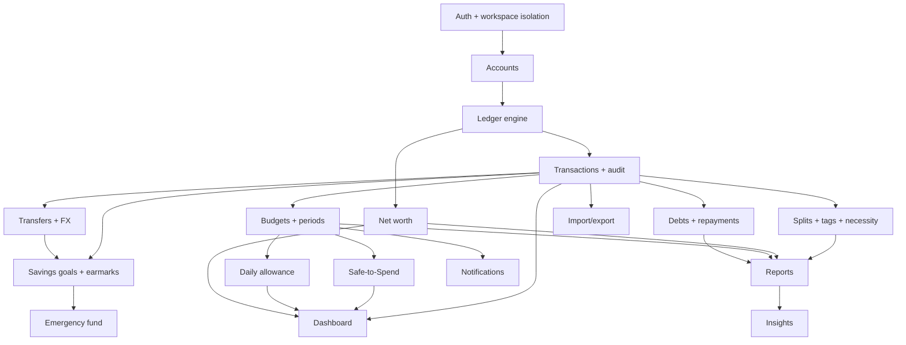

# Feature Matrix — XakuFinance V1.0

Compact planning view. Normative requirements live in `docs/SRS.md`; this file exists to make scope
trade-offs visible. Nothing here is implemented yet.

**Legend:** M = mandatory V1.0 · S = should, may slip to V1.1 · C = could, deferred · W = won't.

## Summary by domain

| Domain | M | S | C | W | Scope verdict |
|---|---:|---:|---:|---:|---|
| Auth & sessions | 15 | 0 | 1 | 0 | Keep. 2FA and recovery codes are in V1. |
| Workspace & isolation | 3 | 0 | 0 | 1 | Keep. Single workspace only. |
| Dashboard | 7 | 0 | 1 | 0 | Keep. Reorder + hide, no grid editor. |
| Accounts | 11 | 0 | 0 | 0 | Keep. Derived balances. |
| Transactions | 11 | 2 | 1 | 2 | Keep. Attachments/OCR explicitly out. |
| Transfers | 9 | 0 | 1 | 0 | Keep, incl. FX and fees. |
| Budgets & periods | 14 | 0 | 1 | 0 | Keep. Positive-only rollover. |
| Savings goals | 9 | 1 | 0 | 0 | Keep. Earmark invariants are critical. |
| Debts | 8 | 1 | 1 | 0 | Keep. No amortization automation. |
| Net worth | 6 | 0 | 1 | 0 | Keep. Ledger-derived history. |
| Safe-to-Spend / allowance | 10 | 0 | 0 | 0 | Keep. Itemized breakdown required. |
| Emergency fund | 6 | 0 | 0 | 0 | Keep. Depends on necessity data. |
| Reports | 12 | 0 | 0 | 0 | Keep. Reconciliation is release-blocking. |
| Insights | 2 | 3 | 0 | 1 | **Phase 4 stretch.** Flag off by default. |
| Notifications | 8 | 0 | 1 | 0 | Keep. Security notifications locked. |
| Import / export | 10 | 0 | 0 | 1 | Keep. Duplicate review required. |
| Privacy / backup / restore | 8 | 0 | 0 | 0 | Keep. Restore must be tested. |
| **Total** | **149** | **7** | **8** | **5** | |

`M` here counts the requirement rows; the SRS tables are authoritative if they differ.

## High-complexity features

| Feature | Why hard | Mitigation |
|---|---|---|
| Double-entry ledger with reversals | Every write path must balance, be atomic, and stay auditable; mistakes corrupt every report | Build and test the ledger engine before any feature uses it; property tests; nightly reconciliation |
| Cross-currency transfers | Rate, rounding, fees, and residual must not create or destroy value | Per-currency balancing, FX clearing account, explicit residual reporting, golden fixtures |
| Historical net worth | Requires point-in-time balances and historical rate policy | Derive from postings as-of date; immutable snapshots as cache only |
| Savings earmark allocation | Virtual claims must never exceed real money or double-count | Row-locked service invariant + DB constraint where possible + concurrency test |
| Transaction edit with audit + reversal | Must preserve history and keep current reports correct | Single service entry point; append-only audit; reversal-then-repost; revision test |
| Budget rollover with custom periods | Boundaries, timezones, proration, and period closing interact | Closed periods immutable; rollover computed at close; proration deferred (C) |
| Duplicate import review | False positives annoy, false negatives corrupt reports | Two-tier detection, human decision, per-group apply, fingerprint audit |
| Safe-to-Spend transparency | Easy to produce a confident-looking wrong number | Itemized response, documented horizon, no AI, tests for each deduction |
| Backup restore | Untested restores are not backups | Restore into a throwaway workspace in CI; checksum and validation gates |

## Dependency graph (feature-level)

## Deliberate simplifications for V1.0

| Original ambition | V1.0 approach | Reason |
|---|---|---|
| Visual dashboard editor | Widget visibility + order list, persisted server-side | Full grid editors cost weeks and rarely improve comprehension |
| Custom budget periods everywhere | Custom periods supported, proration of rollover deferred | Proration rules need product decisions; avoid inventing them |
| AI-powered financial assistant | On-demand explanation of verified summaries only | Financial accuracy and liability |
| Receipt capture | Text descriptions, notes, tags only | Explicitly excluded by the brief |
| Multi-workspace / family sharing | One workspace per user | Explicitly excluded; avoids a permissions subsystem |
| Real-time bank sync | CSV/XLSX import with duplicate review | No aggregation provider in scope |
| Per-transaction multi-currency | Account-currency transactions; FX only in transfers | Keeps every transaction's accounting unambiguous |

## Deferred to V1.1+ (with reason)

| Item | Reason |
|---|---|
| Passkeys / WebAuthn | Valuable, but 2FA + strong passwords cover V1 risk; adds platform complexity |
| Recurring transaction automation | Templates are low risk but interact with pending/duplicate rules; phase after core |
| Scheduled transfers | Requires a scheduler UI and failure handling; V1 supports manual transfers |
| Interest accrual automation | Needs day-count conventions and product decisions |
| Web push | Email + in-app satisfy the requirement |
| Rollover proration for uneven custom periods | Needs a documented day-weighting policy |
| Multi-currency transaction splits | Would complicate split totals and budget matching |
| Attachments / OCR | Out of scope by product decision |
| Investments performance | Different domain (positions, cost basis, market prices) |
| Localization (Khmer) | Copy is i18n-ready; translation and font work is a follow-up |

## V1.0 acceptance gates (summary)

1. Ledger invariant suite green in CI, including concurrency and rollback tests.
2. Every M requirement traced to a test or manual verification record.
3. Cross-tenant isolation tests pass for every endpoint family.
4. Export → restore → reconcile round-trip passes on a seeded workspace.
5. OpenAPI validates; frontend builds against the generated client.
6. Performance targets met at 50k transactions per workspace.
7. Security review complete: auth, 2FA, throttle, secrets, headers, deletion workflow.
8. Accessibility audit passes on all primary flows in both themes.
