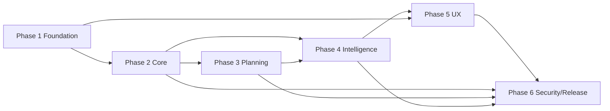

# Development Roadmap — XakuFinance

**Status:** planning baseline. No phase is started.
**Rule:** each milestone leaves the application runnable, migrated, and tested. A milestone is not
complete because code was written.

---

## Phase 0 — Planning and decisions (current)

**Objective:** produce an internally consistent planning package and lock the accounting model before
code.

**Deliverables:** SRS, feature matrix, architecture, database design, accounting rules, API spec, security
model, testing strategy, risks, acceptance criteria, repository structure, ADRs, agent instructions, Phase 1
implementation plan.

**Exit criteria:** documents cross-reference consistently; ledger recipes are arithmetically verified;
every M requirement has an owner phase; open questions are logged with defaults.

**Status:** complete on 2026-11-17. Approval pending.

---

## Phase 1 — Foundation: identity, ledger, accounts, transactions

**Objective:** a user can register, create accounts, record income/expenses, and see balances that
provably derive from a double-entry ledger with audited edits.

### Milestone 1.1 — Project skeleton and CI

**Implementation**
- Repository structure per `docs/REPOSITORY_STRUCTURE.md`.
- Django project with split settings (`base`, `local`, `test`, `production`).
- DRF, drf-spectacular, SimpleJWT, CORS, django-filter, Argon2, `django-environ`-style config.
- PostgreSQL 16 and Redis in Docker Compose; backend, worker, beat, frontend services.
- pytest, ruff, mypy, frontend toolchain, GitHub Actions.
- Health endpoints; structured logging; request-id middleware.
- OpenAPI generation and schema validation in CI.

**Acceptance criteria**
- `docker compose up` brings up API + DB + web; `/health/live` returns 200.
- `pytest` runs (even if trivial), `ruff`/`mypy` pass.
- OpenAPI schema generates and validates; Swagger UI reachable in dev.
- CI green on a fresh clone.

**Tests:** smoke tests for health and schema; config test that secrets come from env.

**Dependencies:** none.

---

### Milestone 1.2 — Identity, workspace, sessions

**Implementation**
- Custom user model, profile, workspace creation on registration.
- Register, login, refresh rotation, logout, session list/revoke, reauth.
- Email verification and password reset (console mailer in dev; Mailpit in Compose).
- Google ID-token endpoint behind a config flag.
- Throttles, lockout, security headers, CORS allowlist.
- `WorkspaceScopedManager` and permission base classes.
- Frontend: auth pages, token handling (access in memory, refresh cookie), route guard, app shell,
  error boundary.

**Acceptance criteria**
- A new user gets exactly one workspace; duplicate registration is rejected.
- Refresh reuse revokes the whole family; logout revokes immediately.
- Protected endpoints reject anonymous requests and cross-workspace ids (404).
- Emails are sent through Mailpit and verification works end-to-end.
- Security headers present in tests.

**Tests:** full identity matrix from `docs/TESTING.md` §4.1; cross-tenant baseline.

**Dependencies:** 1.1.

---

### Milestone 1.3 — Ledger engine

**Implementation**
- `Currency`, `ExchangeRate`, `LedgerAccount`, `JournalEntry`, `Posting`.
- `LedgerService.post(entry_spec)` with per-currency balance assertion, deterministic locking, ledger
  sequence, reversal, pending/complete/cancel transitions.
- System accounts provisioning per workspace.
- Deferred constraint triggers for entry balance and posting currency.
- `check_ledger` management command.
- Money value object (`Money`, `Currency`, `quantize`, `parse_decimal_str`), no floats.
- Property tests for balancing and reversal.

**Acceptance criteria**
- Cannot insert an unbalanced entry through any code path.
- Reversal produces exact negation and marks the original reversed.
- `check_ledger` detects each seeded corruption class.
- Property tests pass 1000+ generated event sequences.
- Ledger sequence increments atomically and is unique per workspace.

**Tests:** integrity suite items 1–5, 35; property tests.

**Dependencies:** 1.2.

---

### Milestone 1.4 — Accounts and opening balances

**Implementation**
- Account CRUD, archive/restore, reorder, spendable flag, negative-balance flag.
- One ledger account per financial account, created atomically.
- Opening balance transaction + equity posting.
- Derived balances selector; account register endpoint with running balance.
- Frontend: accounts list, create/edit sheet, detail with register, archive flow.

**Acceptance criteria**
- Opening balance never appears as income.
- Balance equals posting sum after every operation.
- Archive with balance requires acknowledgement and retains history.
- Delete blocked when postings exist.
- Currency change blocked after postings exist.

**Tests:** accounts matrix + integrity items 3, 13.

**Dependencies:** 1.3.

---

### Milestone 1.5 — Transactions, splits, tags, audit

**Implementation**
- Transaction model + detail tables, splits, tags, necessity, status matrix.
- `TransactionService.create/update/archive/restore/change_status` with reversal + audit revisions.
- Optimistic `version` concurrency.
- Deferred split-total trigger.
- List/detail/summary endpoints with filters and cursor pagination.
- Frontend: transaction list, filters, create/edit forms, split editor, detail drawer with audit,
  archive/restore, pending/cancelled presentation.

**Acceptance criteria**
- Split totals enforced at API and DB level.
- Edit preserves history (reversal + new entry + audit revision).
- Archived transactions excluded by default, included on request.
- Pending never changes balances; completing posts once.
- Audit revisions are append-only and reject updates/deletes.

**Tests:** transactions matrix + integrity items 6–9, 31; E2E scenario 2–3.

**Dependencies:** 1.4.

---

### Milestone 1.6 — Phase 1 hardening

**Implementation**
- Cross-tenant test matrix for every Phase 1 endpoint.
- Query-count tests for list endpoints.
- Seed command for default categories/tags.
- Phase 1 docs update, changelog, and a written limitations list.

**Exit criteria:** all Phase 1 acceptance criteria pass in CI, migration forward/backward tested, no known
P0/P1 defects, ledger reconciliation green.

---

## Phase 2 — Core financial management

**Objective:** transfers, budgets, periods, and imports on top of a trustworthy ledger.

### Milestone 2.1 — Internal transfers

- Same-currency and cross-currency transfers with rate, reference rate, spread, fees.
- FX clearing accounts per currency; conversion fee category.
- Atomicity, idempotency, sufficient-funds checks, archive reversal.
- Frontend: transfer form with live conversion preview, transfer detail, account-linked history.
- Tests: integrity items 10–12, 28–29; E2E scenarios 4–5.

**Exit:** cross-currency transfer reconciles per currency; disabled accounts rejected; double-submit
produces one movement.

### Milestone 2.2 — Categories, tags, necessity analytics

- Category management (2 levels, archive with reassignment guard).
- Tag management, default tags, filters, tag analytics endpoint.
- Necessity classification used in filters and emergency-fund essentials.
- Tests: category ownership, duplicate names, tag analytics reconciliation.

**Exit:** category/tag filters produce ledger-reconciled totals.

### Milestone 2.3 — Budgets, periods, rollover

- Budgets (monthly/weekly/custom series), budget periods, closing job, positive-only rollover with cap.
- Split-aware spend calculation, thresholds, flexibility flags.
- Custom `FinancialPeriod` with non-overlap exclusion constraint.
- Frontend: budget list/detail, period picker, progress visualization, rollover explanation.
- Tests: integrity items 24–25; timezone boundary tests; closed-period immutability.
- E2E scenario 6.

**Exit:** next period available = base + positive unused; overspend never creates negative rollover; closed
periods immutable.

### Milestone 2.4 — CSV/XLSX import with duplicate review

- Upload, mapping, validation, fingerprinting, duplicate scoring, review decisions, atomic commit.
- `ImportJob`/`ImportRecord`/`DuplicateCandidate`; async Celery tasks; cancel.
- Frontend: 4-step import wizard with record table and duplicate group review.
- Tests: integrity item 33; malformed files; atomic rollback; E2E scenario 10.

**Exit:** no row is silently discarded; unresolved duplicates block commit; failure imports zero rows.

### Milestone 2.5 — Phase 2 hardening

- Performance pass on transaction and budget queries; index review.
- Report reconciliation scaffolding (income/expense totals vs ledger).
- Docs + changelog + limitations.

---

## Phase 3 — Financial planning

**Objective:** savings goals, debts, and the emergency fund, all tied to real money.
**Status:** complete on 2026-11-18. All acceptance criteria verified. Report in `docs/reports/PHASE_3_REPORT.md`.

### Milestone 3.1 — Savings goals and earmarks

- Goals, contributions (4 kinds), allocation caps with row locks, archive semantics.
- Transfer-backed contributions; withdrawal flow; projection endpoint.
- Frontend: goal cards, contribute flow (transfer or earmark), allocation capacity display, history,
  over-funding state.
- Tests: integrity items 18–20; concurrency cap test; E2E scenario 7.

**Exit:** total earmarks never exceed account available balance, including concurrent requests; net worth
unaffected by earmarks or goal progress.

### Milestone 3.2 — Debts and repayments

- Liabilities with ledger accounts; disbursement; repayments split principal/interest/fee; interest
  records; payoff projection.
- Frontend: debt list/detail, repayment form with live split preview, net-worth effect explanation.
- Tests: integrity items 14–17; E2E scenario 8.

**Exit:** outstanding always equals liability postings; principal never exceeds outstanding; net worth math
matches the accounting worked example.

### Milestone 3.3 — Emergency fund planner

- Essential expense estimate from necessity-classified spending with overrides.
- Coverage 3/6/12/custom; designated account or goal; contribution plan and ETA; warnings.
- Frontend: planner page with computed-vs-override disclosure.
- Tests: lookback boundaries, overrides, warnings, currency conversion.

**Exit:** example from SRS ($300 × 6 = $1,800) reproduced exactly; computed source always disclosed.

---

## Phase 4 — Financial intelligence (Completed)

**Objective:** historical net worth, Safe-to-Spend, allowance, reports, and optional insights.
**Report:** see [docs/reports/PHASE_4_REPORT.md](reports/PHASE_4_REPORT.md) for full verification certification.

### Milestone 4.1 — Net worth and snapshots (Completed)

- As-of queries over postings; FX policy; snapshot cache keyed by ledger sequence; stale detection.
- Frontend: net worth page with historical chart and accessible table, breakdown, FX effect.
- Tests: integrity items 21, 26–27; historical fixture across rate changes; E2E net worth check.

**Exit:** as-of net worth never uses today's balances; missing rate returns unavailable, never 1:1.

### Milestone 4.2 — Safe-to-Spend and daily allowance (Completed)

- Spendable account designation, pending outflow projection, reserved obligations, planned savings.
- Itemized breakdown; horizon options; clamping and explanation.
- Frontend: dashboard widgets with expandable "how this is calculated"; obligation settings.
- Tests: integrity items 22–23; E2E scenario 9.

**Exit:** every displayed figure maps to a returned component; over-budget shows zero with a reason.

### Milestone 4.3 — Reports and analytics (Completed)

- Income, expense, category, trend, budget, savings, debt, net worth, tag, cashflow reports.
- Reconciliation block on every report; export endpoints reuse filters.
- Frontend: reports shell, filters, charts with table fallback, export action.
- Tests: integrity item 30 + report-specific exact-value tests.

**Exit:** every report reconciles to the ledger; chart tables match series; exports match screen totals.

### Milestone 4.4 — Verification, Hardening & Exit Certification (Completed)

- Query count performance budgets verified ($O(1)$ query complexity, no N+1 loops).
- 0 ledger drift verified across all workspaces.
- OpenAPI 3.1 specification generated and validated with 0 errors.
- Test suites: 271 backend tests passed (100%), 35 frontend tests passed (100%).
- Code quality: ruff, mypy, tsc, and vite production build clean.
- Phase 4 report: `docs/reports/PHASE_4_REPORT.md`.

**Exit:** all Phase 4 acceptance criteria passed and verified. Optional on-demand AI insights gated behind flag.

---

## Phase 5 — User experience (Completed)

**Objective:** make the product pleasant, consistent, and accessible without adding accounting risk.
**Report:** see [docs/reports/PHASE_5_REPORT.md](reports/PHASE_5_REPORT.md) for full verification certification.

### Milestone 5.1 — Customizable dashboard (Completed)

- Widget registry server-side, layout persistence, show/hide/reorder, reset.
- Dashboard assembly endpoint; empty states with reasons; loading skeletons.
- Frontend: widget settings sheet, drag-less reorder (accessible buttons), responsive layout.
- Tests: layout validation, unknown widgets preserved, per-user isolation, E2E dashboard.

**Exit:** preferences persist across devices and sessions; no fabricated zeroes.

### Milestone 5.2 — Notifications and reminders (Completed)

- Notification model, preferences, quiet hours, digests, dedupe, budget threshold scan, bill reminders.
- Security notifications locked; delivery records and failure handling.
- Frontend: notification center, preferences page, badge.
- Tests: dedupe, quiet hours, locked security, email suppression without verified address.

**Exit:** users can configure every category except security; duplicates are not sent.

### Milestone 5.3 — Settings, themes, responsive polish (Completed)

- Profile/workspace settings, reporting currency changes, timezone/week start.
- Light/dark/system themes with token audit; responsive pass at 360/768/1024/1440.
- Empty, loading, error, and offline-ish states; copy review.
- Accessibility pass: focus, labels, contrast, keyboard, reduced motion.

**Exit:** WCAG 2.2 AA practical audit passes on primary flows in both themes; no illegible token pair.

### Milestone 5.4 — Verification, Hardening & Exit Certification (Completed)

- Query count performance budgets verified across all Phase 5 endpoints.
- 0 ledger drift verified across all workspaces.
- OpenAPI 3.1 specification generated and validated with 0 errors.
- Test suites: 295 backend tests passed (100%), 43 frontend tests passed (100%).
- Code quality: ruff, mypy, tsc, and vite production build clean.
- Phase 5 report: `docs/reports/PHASE_5_REPORT.md`.

**Exit:** all Phase 5 acceptance criteria passed and verified. Ready for Phase 6 (Security and Release).

---

## Phase 6 — Security and release

**Objective:** ship only what has been verified, backed up, and can be deleted on request.
**Status:** complete on 2026-11-19. All acceptance criteria verified. Report in `docs/reports/SECURITY_AND_RELEASE_REPORT.md`.

### Milestone 6.1 — 2FA and recovery (Completed)

- TOTP enrollment/confirm/disable, encrypted secrets, replay protection, recovery codes, reauth.
- Frontend: security settings, QR provisioning, recovery code download/copy, login challenge.
- Tests: full 2FA matrix + E2E scenario 12.

**Exit:** 2FA cannot be enabled without proof of possession; recovery codes are single-use; disabling
requires both factors.

### Milestone 6.2 — Privacy, export, deletion (Completed)

- Full data export (async, signed URL), data map, deletion request with grace period and execution job.
- Truthful backup-retention messaging.
- Tests: privacy matrix + E2E scenario 13.

**Exit:** deletion removes live data and states backup expiry truthfully; export requires reauth.

### Milestone 6.3 — Backups and restore (Completed)

- Nightly encrypted `pg_dump`, checksums, retention, verification, failure alerting.
- Manual user backup, restore into empty workspace, validation report, reconciliation gate.
- Frontend: backup list/download, restore wizard.
- Tests: integrity item 34 + nightly restore drill.

**Exit:** a backup has been restored and reconciled in CI; corrupted archives are refused.

### Milestone 6.4 — Hardening, load, and launch (Completed)

- SAST/DAST, dependency audit, header/CSP verification, rate-limit load test.
- Performance tests at 50k transactions; index tuning.
- Independent penetration test; fix or accept findings.
- Deployment runbook, monitoring, alerts, on-call basics, rollback plan.
- Final acceptance checklist.

**Exit:** all of `docs/ACCEPTANCE_CRITERIA.md` complete; no open P0/P1; restore drill green; pen-test
findings closed or explicitly accepted.

---

## Cross-phase dependencies

Hard constraints:

- No feature may bypass the ledger engine (Phase 1.3).
- Budgets (2.3) precede Safe-to-Spend and daily allowance (4.2).
- Savings earmarks (3.1) precede the emergency fund's goal linkage (3.3).
- Notifications (5.2) depend on budget thresholds (2.3) and savings milestones (3.1).
- Exports (6.2) depend on all entity schemas being stable; restore must understand every table.

### Milestone dependency and test index

Every milestone records these six fields: objective (title), implementation, dependencies, acceptance
criteria, tests, and completion condition. The table makes the dependency and test links explicit.

| Milestone | Depends on | Test evidence |
|---|---|---|
| 1.1 Skeleton/CI | — | health, schema validation, lint/type checks |
| 1.2 Identity/workspace | 1.1 | auth matrix, one-workspace constraint, isolation baseline |
| 1.3 Ledger engine | 1.2 | balancing, reversal, property tests, `check_ledger` |
| 1.4 Accounts/opening | 1.3 | equity posting, archive rules, derived balance |
| 1.5 Transactions/splits/audit | 1.4 | split totals, edit reversal, audit append-only |
| 1.6 Phase 1 hardening | 1.5 | cross-tenant matrix, query counts |
| 2.1 Transfers | 1.6 | FX balancing, fee separation, atomic rollback, idempotency |
| 2.2 Categories/tags/necessity | 2.1 | ownership, analytics reconciliation |
| 2.3 Budgets/periods/rollover | 2.2 | timezone/DST boundaries, positive-only rollover, closed periods |
| 2.4 Import/duplicates | 2.3 | duplicate decisions, atomic commit |
| 2.5 Phase 2 hardening | 2.4 | report reconciliation scaffold, performance |
| 3.1 Savings/earmarks | 2.5 | earmark cap concurrency, net-worth neutrality |
| 3.2 Debts | 3.1 | principal/interest split, outstanding derivation |
| 3.3 Emergency fund | 3.2 | 300×6, computed vs override |
| 4.1 Net worth/snapshots | 3.3 | as-of history, FX policy, snapshot invalidation |
| 4.2 Safe-to-Spend/allowance | 4.1 | itemization, zero-floor, horizon |
| 4.3 Reports | 4.2 | every report reconciles to ledger |
| 4.4 Insights | 4.3 | number verification, disabled-flag behavior |
| 5.1 Dashboard | 4.3 | layout persistence, empty states |
| 5.2 Notifications | 5.1 | dedupe, quiet hours, locked security |
| 5.3 Settings/themes/a11y | 5.2 | contrast, keyboard, responsive matrix |
| 6.1 2FA | 5.3 | enrollment, replay, recovery single-use |
| 6.2 Privacy/export/deletion | 6.1 | deletion E2E, retention copy, reauth |
| 6.3 Backups/restore | 6.2 | restore drill, checksum, reconciliation |
| 6.4 Hardening/launch | 6.3 | load, SAST/DAST, pen test, acceptance checklist |

## Timeline reality check

This is a solo-developer-scale product with a financial core. A realistic sequence, not a promise:

| Phase | Focus | Indicative effort |
|---|---|---|
| 1 | Skeleton, auth, ledger, accounts, transactions | 6–9 weeks |
| 2 | Transfers, budgets, imports | 5–7 weeks |
| 3 | Savings, debts, emergency fund | 4–6 weeks |
| 4 | Net worth, Safe-to-Spend, reports, insights | 5–7 weeks |
| 5 | Dashboard, notifications, themes, responsiveness | 3–5 weeks |
| 6 | 2FA, privacy, backups, hardening, launch | 4–6 weeks |

These are estimates for one experienced full-stack developer working consistently. The ledger and reporting
phases are the most likely to overrun; they are also the phases where cutting corners is least acceptable.

## Deferred items (no phase in V1)

Passkeys, recurring transactions, scheduled transfers, interest accrual automation, web push, rollover
proration, multi-currency splits, attachments/OCR, investment performance, Khmer localization, multi-user
workspaces. See `docs/FEATURE_MATRIX.md`.
